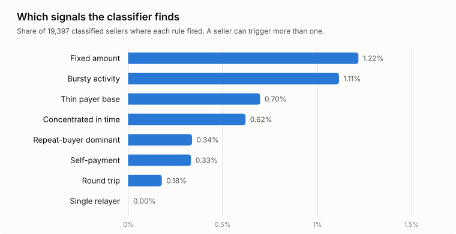
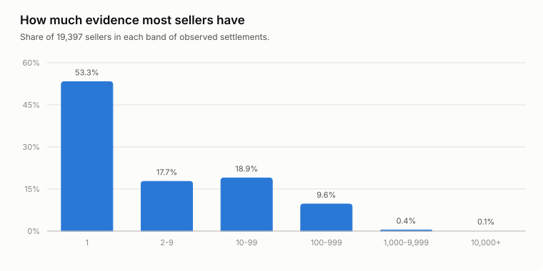
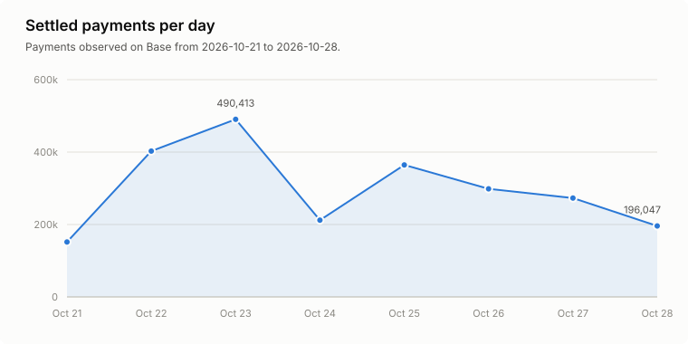

# Zapproof: what the settled payment data shows

*A public Phase B analysis, methodology `v1`. Generated 2026-11-25 from
the index at block 53,201,719.*

## What this is

Zapproof reads settled payments made by software agents and summarises the payment
record of the seller on the other side. The product answers one narrow question with
evidence: **how much settled payment activity does this address have, and how much of it
looks like the seller paying itself rather than a real customer?**

It is not a credit score, a dishonesty verdict or a judgement about a person or
company. A
seller with no record is **unknown, not bad**. The service returns `found: false` rather
than a score of zero.

## The data behind this analysis

- **2,389,053 settled payments** made through one settlement mechanism on
  Base, from 2026-10-21 to 2026-10-28.
- **19,397 seller addresses** with enough activity to classify.
- **1,433 sellers** met the evidence minimum and received a score;
  **17,964** had some evidence but not enough and received
  `insufficient_evidence`.
- One token (USDC, 6 decimals) and one chain. Lightning is **not** indexed.

The observation window is short: the first and last settlement are
7.1 days apart. Nothing here should be read as a seasonality or
growth claim.

## What a score means in plain language

A score runs from 0 to 100. It rises with evidence — settlements, distinct payers and
active days — and falls when the payment pattern matches one of eight named signals.

A score is produced only when **all three** of these hold: at least 20 settlements, at
least 5 distinct payers, and at least 3 active days. Below any of them the answer is
`insufficient_evidence`, with no number. Each evidence dimension saturates at four times
the minimum, so sheer volume stops helping early.

The signalling side is a transparent rule set, not a trained model:

| Rule | Weight | Fires when |
|---|---|---|
| Self-payment | 0.45 | the payer and the seller are the same address |
| Thin payer base | 0.30 | many settlements from three or fewer payers |
| Repeat-buyer dominant | 0.20 | ten or fewer payers, most buying more than once |
| Fixed amount | 0.20 | near-identical amounts from a small payer set |
| Bursty activity | 0.15 | payments arrive in one burst rather than steadily |
| Concentrated in time | 0.30 | half the settlements fall inside a single hour |
| Single relayer | 0.10 | one facilitator carried almost everything |
| Round trip | 0.15 | payers also received payments from the seller |

Weights total 1.85, so several rules firing at once clamp at 1.0. That number means
"as signalling-like as this method can express", not "certainly dishonest". The weights
judgement, not measurement, and the sensitivity analysis perturbs every threshold by
±25%.

Among the 1,433 sellers with a score, values ranged from
2.5 to 88.9 (mean 71.5). The
mean is high because most scored sellers have substantial, diverse payment histories;
the signals below are rare.

## What the rules find



| Signal | Sellers | Share |
|---|---:|---:|
| Fixed amount | 236 | 1.22% |
| Bursty activity | 216 | 1.11% |
| Thin payer base | 135 | 0.70% |
| Concentrated in time | 120 | 0.62% |
| Repeat-buyer dominant | 65 | 0.34% |
| Self-payment | 64 | 0.33% |
| Round trip | 34 | 0.18% |
| Single relayer | 0 | 0.00% |

**3.0% of sellers** triggered at least one rule;
the rest triggered none. These are not a dishonesty rate. Each rule is a pattern worth
looking at, and several have innocent explanations the classifier itself records in its
per-rule notes.


## How much evidence most sellers have



| Settlements per seller | Sellers | Share |
|---|---:|---:|
| 1 | 10,329 | 53.3% |
| 2-9 | 3,436 | 17.7% |
| 10-99 | 3,672 | 18.9% |
| 100-999 | 1,871 | 9.6% |
| 1,000-9,999 | 75 | 0.4% |
| 10,000+ | 14 | 0.1% |

More than half the sellers appear once. That is the population a payment index sees:
many addresses that received a single payment, and a long tail that sells repeatedly.
A single payment is not evidence of anything, which is why the score abstains rather
than guessing.

## Payments per day



| Day | Settlements |
|---|---:|
| Oct 21 | 151,848 |
| Oct 22 | 402,635 |
| Oct 23 | 490,413 |
| Oct 24 | 212,082 |
| Oct 25 | 364,457 |
| Oct 26 | 298,616 |
| Oct 27 | 272,955 |
| Oct 28 | 196,047 |

Daily volume varied between 151,848 and
490,413. With 7.1 days of data
there is no basis for a trend claim.

## Limitations

1. **Settlement counts are not independently cross-verified.** No zero-cost independent
   source exists. Every published number carries that caveat.
2. **An on-chain authorisation event is not provably an x402 settlement.** The
   distinction lives off-chain, and this population is defined by that event.
3. **The classifier is a rule set someone wrote down.** It cannot find a pattern nobody
   thought of.
4. **The interpretation was checked against language-model adjudicators, not humans.**
   Agreement was 61.5% counting abstentions as disagreements
   (83.3% excluding them), and the two
   inter-rater files are identical, so the recorded inter-rater figure is not
   independent evidence. See `docs/METHODOLOGY.md`.
5. **The window is 7.1 days, one chain and one token.** Results may
   not hold for another period, chain, token or rail.
6. **Synthetic validation is partly circular.** Planted-pattern tests measure whether the
   rules find patterns the same person planted; they test mechanics, not truth.

## Corrections

If you operate a seller and believe a record is wrong, `DISPUTES.md` explains how to
contest a label or score and how corrections are logged.

## Reproducing this analysis

```bash
uv sync
uv run python scripts/public_analysis.py     # writes this report and the charts
uv run python scripts/rebuild_derived.py     # recompute derived tables
```

`scripts/public_analysis.py` opens `data/repindex.db` read-only, publishes aggregates
only, and writes deterministic SVG. The charts use a single series colour and print
their values beside the marks; every value is also in the tables above.

Provenance of this run: commit `bd4b7f89776f11a395eeca56707394151e33858f`, database fingerprint `025b8a39bb8e1029`.
